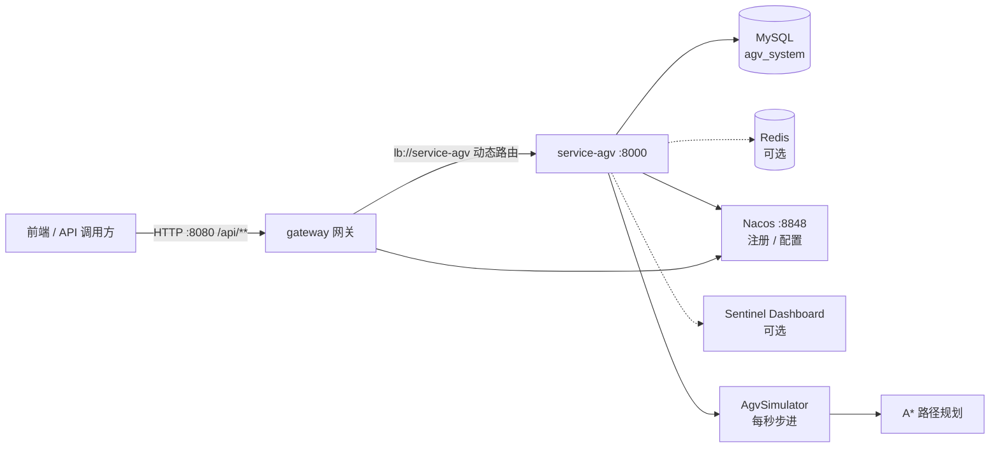
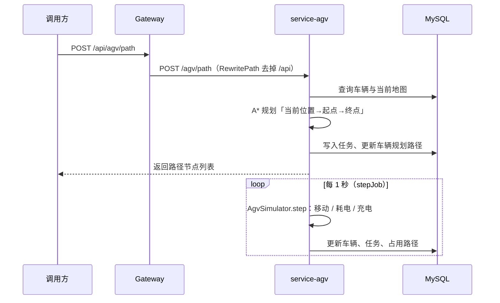

# AGV 智能调度与地图管理系统

基于 Spring Cloud 微服务架构的 AGV（Automated Guided Vehicle，自动导引车）仿真与调度平台。系统提供栅格地图管理、A* 路径规划、任务调度、车辆状态模拟、低电量自动充电、运行日志查询等能力，适合作为 AGV 调度算法的学习、演示与二次开发基础。

> 仓库地址：
> - Gitee：<https://gitee.com/blood-sugar/agv-map-system>
> - GitHub：<https://github.com/lizhi-03/agv-system>

---

## 目录

- [功能特性](#功能特性)
- [技术栈](#技术栈)
- [系统架构](#系统架构)
- [模块说明](#模块说明)
- [目录结构](#目录结构)
- [快速开始](#快速开始)
- [接口一览](#接口一览)
- [核心流程与算法](#核心流程与算法)
- [构建与部署](#构建与部署)
- [单元测试](#单元测试)
- [配置说明](#配置说明)
- [已知限制与注意事项](#已知限制与注意事项)

---

## 功能特性

### 地图管理
- 保存地图并自动维护**版本链**：新地图继承上一版本 `version + 1`，旧地图置为非当前版本
- 地图由栅格尺寸、障碍物（`obstacles`）、站点（`stations`）组成，均以 JSON 形式存储在 MySQL
- 查询当前生效地图、站点列表（充电站等）与车辆历史路径

### AGV 管理
- 查询单辆 / 全部 AGV 的实时位置、朝向、速度、电量、状态、当前任务与规划路径
- 动态批量加车（`AGVplus0001` 起编号）
- 手动启动 / 停止车辆、调节速度、上报车辆位置
- 遥控前往最近的充电站

### 任务调度
- 创建物料运输任务：自动计算「当前位置 → 起点 → 终点」路径并下发
- 任务分页查询、取消任务、清空全部任务
- 任务状态流转：`waiting` / `processing` / `paused` / `completed` / `failed` / `cancelled`

### 路径规划
- A* 算法实现（`GridMap` + `AStarSolver`）
- 支持四方向 / 八方向（对角）移动，默认四方向
- 支持曼哈顿、欧几里得、切比雪夫三种启发式函数
- 障碍物、站点、以及其他车辆已占用路径均参与避让
- 车辆移动过程中按当前位置**实时重规划**路径

### 车辆仿真
- 基于 Spring `TaskScheduler` 的 1 秒步进模拟（`AgvSimulator`）
- 按速度计算耗电；电量 ≤ 30% 自动规划前往充电站，充电时每秒恢复 5% 电量，电量 > 95% 后恢复空闲
- 每次步进将车辆、任务、占用路径持久化到数据库
- 定时任务统计在线车辆数并写入系统日志

### 其他
- 统一响应结构 `Result<T>` 与分页结构 `PageResult<T>`
- 系统日志分级记录（`info` / `warning` / `error`）与分页查询
- 基于分离轴定理（SAT）的矩形碰撞检测工具类 `AgvCollisionAvoidance`（默认未启用）
- 测试代码中包含动态数组、链表、栈、队列、堆、二叉搜索树、AVL、红黑树、哈希表等数据结构练习与 JUnit 5 测试

---

## 技术栈

| 分类 | 技术 / 版本 |
| --- | --- |
| 语言 | Java 17 |
| 基础框架 | Spring Boot 3.3.4 |
| 微服务 | Spring Cloud 2023.0.3、Spring Cloud Alibaba 2023.0.3.2 |
| 网关 | Spring Cloud Gateway |
| 服务调用 | OpenFeign、Spring Cloud LoadBalancer |
| 注册 / 配置中心 | Nacos 2.x |
| 流量防护 | Sentinel（可选） |
| 分布式事务 | Seata（当前关闭） |
| 持久层 | MyBatis 3.0.3、MyBatis-Plus 3.5.5、PageHelper 1.4.6 |
| 数据库 | MySQL 8.x |
| 缓存 | Spring Data Redis（已引入依赖，当前代码未使用） |
| 工具库 | Lombok、Hutool 5.8.27、Fastjson 1.2.83 |
| 测试 | JUnit 5（Spring Boot Starter Test） |
| 构建 | Maven 3.8+ |

---

## 系统架构



- 所有外部请求建议统一从网关 `http://localhost:8080/api/**` 进入
- 网关通过 `RewritePath` 去掉 `/api` 前缀，再按服务名 `lb://service-agv` 负载均衡转发
- `service-agv` 负责全部业务逻辑与车辆仿真，数据持久化到 MySQL
- 服务启动时会向 Nacos 注册；`seata.enabled=false`，当前不启用分布式事务

---

## 模块说明

| 模块 | 说明 |
| --- | --- |
| `agv-system`（根 `pom.xml`） | 父工程，统一依赖版本与打包配置（共享 `lib` 输出） |
| `agv-model` | 公共模型模块：PO / DTO / Query、统一响应 `Result` / `PageResult`、MyBatis JSON 类型处理器 |
| `agv-service` | 业务服务聚合模块（`pom` 打包），聚合 `service-agv` |
| `agv-service/service-agv` | AGV 核心服务：Controller、Service、Mapper、A* 算法、车辆仿真、定时任务、Feign 客户端 |
| `gateway` | Spring Cloud Gateway 网关，路由 `/api/**` 到 `service-agv` |
| `agv/`、`agv-service/agv/` | Maven 构建输出目录：可执行 jar + 公共 `lib/`（已提交到仓库） |
| `service-agv/src/test` | 数据结构练习实现与 JUnit 5 单元测试 |

---

## 目录结构

```
agv-system
├── pom.xml                              # 父工程：依赖管理 + 统一打包配置
├── agv-model/
│   └── src/main/java/com/lizhi/
│       ├── domain/
│       │   ├── po/                      # AgvMap / AgvTask / AgvSnapshot / AgvPath / AgvLog / Node ...
│       │   ├── dto/                     # 接口出入参对象
│       │   └── query/                   # 分页查询对象
│       ├── handler/                     # ListTypeHandler / NodeListTypeHandler（JSON 与 List 互转）
│       └── result/                      # Result / PageResult
├── agv-service/
│   ├── pom.xml
│   └── service-agv/
│       ├── src/main/java/com/lizhi/
│       │   ├── MapMainApplication.java  # 服务启动类（@EnableScheduling / @EnableFeignClients）
│       │   ├── astart/                  # A* 路径规划
│       │   │   ├── map/GridMap.java     # 栅格地图、邻居、障碍物（权重 -1）
│       │   │   ├── heuristic/           # Manhattan / Euclidean / Chebyshev
│       │   │   └── service/AStarSolver.java
│       │   ├── controller/              # AGV / 地图 / 任务 / 日志 接口
│       │   ├── service/impl/            # 业务实现
│       │   ├── mapper/                  # MyBatis Mapper 接口
│       │   ├── feign/                   # 服务间调用（自动充电）
│       │   ├── job/stepJob.java         # 定时任务：1 秒步进、在线车辆统计
│       │   └── utils/
│       │       ├── AgvSimulator.java    # 车辆仿真核心（移动、耗电、充电）
│       │       ├── AgvUnlock.java       # 栅格地图构建 + 实时路径规划
│       │       ├── AgvConversion.java   # JSON/LinkedHashMap 与强类型对象转换
│       │       └── AgvCollisionAvoidance.java  # SAT 矩形碰撞检测
│       ├── src/main/resources/
│       │   ├── application.yml          # 服务端口、MySQL、Nacos、Sentinel 配置
│       │   ├── application.properties   # 端口与 Nacos 地址（与 yml 保持一致）
│       │   └── mapper/*.xml             # MyBatis SQL 映射
│       └── src/test/java/com/lizhi/     # 数据结构练习与单元测试
├── gateway/
│   └── src/main/resources/
│       ├── application.yml              # 网关端口 8080、Nacos 注册
│       └── application-route.yml        # /api/** 路由规则
├── agv/                                 # gateway 构建输出（jar + lib）
└── agv-service/agv/                     # service-agv 构建输出（jar + lib）
```

---

## 快速开始

### 1. 环境要求

| 组件 | 版本要求 | 说明 |
| --- | --- | --- |
| JDK | **17** | 项目 `maven.compiler.source/target` 均为 17，使用 JDK 8/11 会编译失败 |
| Maven | 3.8+ | |
| MySQL | 8.x | 数据库名默认 `agv_system` |
| Nacos | 2.x | 默认地址 `127.0.0.1:8848`，用于服务注册与发现 |
| Redis | 可选 | 已引入依赖，当前代码未实际使用 |
| Sentinel Dashboard | 可选 | 默认配置地址 `localhost:8080`，注意与网关端口冲突 |

> Windows 下如果默认 `java -version` 不是 17，请先切换 `JAVA_HOME`：
> `set JAVA_HOME=C:\path\to\jdk-17`（PowerShell：`$env:JAVA_HOME="C:\path\to\jdk-17"`）

### 2. 初始化数据库

创建数据库 `agv_system`（与 `application.yml` 中 `spring.datasource.url` 保持一致），并执行以下建表语句：

```sql
CREATE DATABASE IF NOT EXISTS agv_system DEFAULT CHARACTER SET utf8mb4 COLLATE utf8mb4_general_ci;
USE agv_system;

-- 地图（含版本链）
CREATE TABLE IF NOT EXISTS agv_map (
    map_id      INT PRIMARY KEY AUTO_INCREMENT,
    map_code    VARCHAR(64)  NOT NULL COMMENT '地图唯一编码',
    map_name    VARCHAR(64)           COMMENT '地图名称',
    width       INT                   COMMENT '地图宽度（格）',
    height      INT                   COMMENT '地图高度（格）',
    cell_size   INT                   COMMENT '单元格大小',
    description VARCHAR(255)          COMMENT '描述',
    obstacles   JSON                  COMMENT '障碍物坐标列表',
    stations    JSON                  COMMENT '站点列表（id/type/x/y）',
    version     INT DEFAULT 0         COMMENT '版本号',
    is_current  INT DEFAULT 0         COMMENT '1=当前版本 0=历史版本',
    parent_id   INT DEFAULT 0         COMMENT '上一版本地图ID，0为首版',
    created_at  DATETIME DEFAULT CURRENT_TIMESTAMP,
    updated_at  DATETIME DEFAULT CURRENT_TIMESTAMP ON UPDATE CURRENT_TIMESTAMP
) ENGINE=InnoDB DEFAULT CHARSET=utf8mb4 COMMENT='AGV 地图';

-- AGV 实时状态快照
CREATE TABLE IF NOT EXISTS agv_snapshot (
    agv_code     VARCHAR(32) PRIMARY KEY COMMENT 'AGV 编号',
    x            INT DEFAULT 0,
    y            INT DEFAULT 0,
    direction    INT DEFAULT 0     COMMENT '朝向角度',
    status       VARCHAR(16) DEFAULT 'idle' COMMENT 'idle/running/stopping/charging/error',
    battery      DOUBLE DEFAULT 100 COMMENT '电量百分比',
    speed        INT DEFAULT 0     COMMENT '速度 cm/s',
    task_id      INT NULL          COMMENT '当前任务ID',
    description  VARCHAR(255)      COMMENT '当前任务描述',
    last_update  VARCHAR(64)       COMMENT '最后更新时间（ISO8601）',
    planned_path TEXT              COMMENT '规划路径（JSON 节点数组）',
    path_index   INT DEFAULT 0     COMMENT '当前路径索引',
    is_charge    INT DEFAULT 0     COMMENT '0=未充电 1=充电中'
) ENGINE=InnoDB DEFAULT CHARSET=utf8mb4 COMMENT='AGV 状态快照';

-- 任务
CREATE TABLE IF NOT EXISTS agv_task (
    task_id            INT PRIMARY KEY AUTO_INCREMENT,
    task_code          VARCHAR(64) NOT NULL COMMENT '任务编号',
    agv_code           VARCHAR(32)          COMMENT '执行车辆',
    task_type          VARCHAR(32)          COMMENT '物料运输/充电',
    status             VARCHAR(16)          COMMENT 'waiting/processing/paused/completed/failed/cancelled',
    priority           VARCHAR(16)          COMMENT 'low/medium/high',
    source             VARCHAR(64)          COMMENT '起点站点编号',
    destination        VARCHAR(64)          COMMENT '终点站点编号',
    start_time         DATETIME             COMMENT '开始时间',
    estimated_end_time DATETIME             COMMENT '预计结束时间',
    actual_end_time    DATETIME             COMMENT '实际结束时间',
    description        VARCHAR(255)         COMMENT '任务描述',
    created_at         DATETIME DEFAULT CURRENT_TIMESTAMP,
    updated_at         DATETIME DEFAULT CURRENT_TIMESTAMP ON UPDATE CURRENT_TIMESTAMP,
    start_point_x      INT                  COMMENT '起点 X',
    start_point_y      INT                  COMMENT '起点 Y',
    pass_mid_point     INT DEFAULT 0        COMMENT '0=无需经过起点 1=需先经过起点'
) ENGINE=InnoDB DEFAULT CHARSET=utf8mb4 COMMENT='AGV 任务';

-- 车辆占用路径（用于实时避让）
CREATE TABLE IF NOT EXISTS agv_path (
    path_id  BIGINT PRIMARY KEY AUTO_INCREMENT,
    agv_code VARCHAR(32),
    x        INT,
    y        INT,
    type     VARCHAR(16) DEFAULT 'path',
    map_id   INT,
    KEY idx_agv_code (agv_code),
    KEY idx_map_id (map_id)
) ENGINE=InnoDB DEFAULT CHARSET=utf8mb4 COMMENT='AGV 占用路径点';

-- 系统日志
CREATE TABLE IF NOT EXISTS agv_log (
    log_id     INT PRIMARY KEY AUTO_INCREMENT,
    `timestamp` DATETIME DEFAULT CURRENT_TIMESTAMP,
    level      VARCHAR(16)  COMMENT 'info/warning/error',
    message    VARCHAR(500) COMMENT '日志内容',
    created_at DATETIME DEFAULT CURRENT_TIMESTAMP
) ENGINE=InnoDB DEFAULT CHARSET=utf8mb4 COMMENT='系统日志';
```

> 上述 DDL 根据实体类与 Mapper SQL 反推整理，字段含义与代码保持一致；如已有生产库，请以实际表结构为准。

### 3. 启动基础设施

```bash
# 1) 启动 MySQL（默认 3306，账号 root/root）
# 2) 启动 Nacos（单机模式）
# Windows
startup.cmd -m standalone
# Linux / macOS
sh startup.sh -m standalone

# 3)（可选）启动 Redis
# 4)（可选）启动 Sentinel Dashboard，注意修改端口避免与网关 8080 冲突
```

### 4. 修改配置

`agv-service/service-agv/src/main/resources/application.yml`：

```yaml
spring:
  datasource:
    url: jdbc:mysql://localhost:3306/agv_system?allowPublicKeyRetrieval=true&useSSL=false&serverTimezone=UTC
    username: root
    password: root            # 按实际环境修改
  cloud:
    nacos:
      server-addr: 127.0.0.1:8848   # 按实际环境修改
server:
  port: 8000                  # 业务服务端口
```

`gateway/src/main/resources/application.yml`：

```yaml
spring:
  cloud:
    nacos:
      discovery:
        server-addr: 127.0.0.1:8848
server:
  port: 8080                  # 网关端口
```

### 5. 编译

```bash
# 需确保 JAVA_HOME 指向 JDK 17
mvn -DskipTests clean package
```

构建产物：

| 产物 | 路径 |
| --- | --- |
| 网关 | `agv/gateway-1.0-SNAPSHOT.jar` |
| AGV 服务 | `agv-service/agv/service-agv-1.0-SNAPSHOT.jar` |
| 公共依赖 | `agv/lib/`、`agv-service/agv/lib/` |

### 6. 启动服务

先启动 `service-agv`，再启动 `gateway`（保证 Nacos 中已有服务实例）：

```bash
java -jar agv-service/agv/service-agv-1.0-SNAPSHOT.jar
java -jar agv/gateway-1.0-SNAPSHOT.jar
```

或在 IDE 中分别运行：

- `com.lizhi.MapMainApplication`（业务服务，端口 8000）
- `com.lizhi.GatewayMainApplication`（网关，端口 8080）

### 7. 验证

```bash
# 通过网关访问（/api 前缀会被 RewritePath 去掉）
curl http://localhost:8080/api/agv/list -X POST

# 直连业务服务
curl http://localhost:8000/agv/list -X POST
```

---

## 接口一览

> 通过网关访问时，统一在各个接口路径前加 `/api`。
> 例：`POST http://localhost:8080/api/agv/path` 实际转发到 `POST http://service-agv/agv/path`。

### AGV 管理 `AgvController`（`/agv`）

| 方法 | 路径 | 说明 | 请求体 |
| --- | --- | --- | --- |
| POST | `/agv/batch/{mun}` | 动态批量加车 | - |
| POST | `/agv/charge/{agvCode}` | 遥控车辆前往最近充电站 | - |
| GET | `/agv/{agvCode}` | 查询指定车辆状态 | - |
| POST | `/agv/list` | 查询全部车辆状态 | - |
| POST | `/agv/report` | 上报车辆当前位置 | `AgvSnapshotDTO` |
| POST | `/agv/path` | 创建并开始执行任务 | `AgvTaskDTO` |
| POST | `/agv/stop` | 暂停车辆运行 | `AgvSnapshotDTO` |
| POST | `/agv/start` | 恢复车辆运行 | `AgvSnapshotDTO` |
| POST | `/agv/speed` | 调节车辆速度 | `AgvSnapshotDTO`（`agvCode`、`speed`） |
| POST | `/agv/clear` | 清除所有任务 | - |

创建任务请求示例：

```json
{
  "agvCode": "AGV001",
  "taskCode": "T20261102001",
  "startPoint": { "id": "S1", "x": 10, "y": 10 },
  "endPoint":   { "id": "S2", "x": 50, "y": 40 },
  "currentPoint": { "x": 0, "y": 0 }
}
```

### 地图管理 `AgvMapController`（`/map`）

| 方法 | 路径 | 说明 |
| --- | --- | --- |
| POST | `/map/save` | 保存地图（生成新版本） |
| GET | `/map/current` | 获取当前地图、站点与车辆路径 |
| POST | `/map/reset` | 重置 / 获取当前地图 |
| GET | `/map/station` | 获取当前地图站点列表 |

### 任务管理 `AgvTaskController`（`/task`）

| 方法 | 路径 | 说明 |
| --- | --- | --- |
| POST | `/task/page` | 任务分页查询（`page`、`pageSize`、`taskCode`） |
| GET | `/task/cancel/{taskId}` | 取消任务 |

### 日志管理 `AgvLogController`（`/log`）

| 方法 | 路径 | 说明 |
| --- | --- | --- |
| POST | `/log/page` | 系统日志分页查询（`page`、`pageSize`） |

### 统一响应

```json
{
  "code": 200,
  "msg": null,
  "data": {}
}
```

- `code = 200`：成功
- `code = 204`：业务失败（`msg` 为错误信息）
- 分页数据：`{ "total": 100, "records": [] }`

---

## 核心流程与算法

### 任务执行流程



### A* 路径规划

1. `AgvUnlock.realTimePath()` 根据当前地图构建 `GridMap`：
   - 障碍物、站点默认权重设为 `-1`（不可通行）
   - 起点与终点重新设回可通行
   - 其他车辆已占用的路径点也设为不可通行，规划完成后恢复
2. `AStarSolver` 使用 `openList` / `closedList` 迭代扩展，按 `f = g + h` 选取最小代价节点
3. `g` 的估算：对角移动使用欧几里得距离，直线移动使用曼哈顿距离；`h` 使用曼哈顿距离
4. 达到目标后通过 `parent` 指针回溯并反转，得到完整路径

### 车辆仿真与充电

- `AgvSimulator.createAndStart()` 为每辆车注册 1 秒一次的任务
- 移动：每次最多移动 1 格，方向角按八方向更新
- 耗电：`max(0.1, speed / 1000)` 每步，速度越快耗电越多
- 低电量：电量 ≤ 30% 时自动规划前往 `type = "charge"` 的最近充电站
- 充电：`charging` 状态每秒恢复 5% 电量，> 95% 后转为 `idle` 并完成任务

### 碰撞检测（可选）

`AgvCollisionAvoidance` 使用分离轴定理（SAT）计算两个旋转矩形在四条轴上的投影区间，判断是否重叠。`stepJob` 中相关逻辑目前处于注释状态，可按需开启。

---

## 构建与部署

### 共享依赖打包机制

根 `pom.xml` 对打包行为做了统一配置：

- `maven-jar-plugin`：生成 jar 的 `MANIFEST.MF`，设置 `Class-Path` 指向 `lib/`
- `maven-dependency-plugin`：`package` 阶段将所有依赖复制到模块的 `${boot-jar-output}/lib`
- `spring-boot-maven-plugin`：以 `ZIP` 布局重新打包，且不内嵌第三方依赖，输出到 `${boot-jar-output}`

因此两个可执行 jar 共用各自的 `lib/` 目录，部署时需保持 `jar + lib` 的相对位置不变。

### 部署目录示例

```
deploy/
├── agv/
│   ├── gateway-1.0-SNAPSHOT.jar
│   └── lib/
└── service/
    ├── service-agv-1.0-SNAPSHOT.jar
    └── lib/
```

```bash
java -jar deploy/service/service-agv-1.0-SNAPSHOT.jar
java -jar deploy/agv/gateway-1.0-SNAPSHOT.jar
```

> 如需修改输出目录，可调整根 `pom.xml` 中的 `boot-jar-output` 属性及各子模块的覆盖配置。

---

## 单元测试

测试代码位于 `agv-service/service-agv/src/test/java/com/lizhi/`：

- `method/array`：动态数组、二分查找、数组栈
- `method/link`：单向链表、双向链表、带哨兵双向链表、链表栈
- `method/queue`：数组队列、链表队列、双端队列、阻塞队列、优先级队列
- `method/heap`：大顶堆、小顶堆
- `method/tree`：二叉搜索树、AVL 树、红黑树、二叉树题目
- `method/hash`：哈希表及其 JUnit 5 测试
- `test.java`：各类数据结构的综合验证

执行测试：

```bash
mvn test
```

> `src/test` 下的数据结构实现用于学习与验证，不参与主业务运行。

---

## 配置说明

| 配置项 | 位置 | 默认值 | 说明 |
| --- | --- | --- | --- |
| `server.port` | `service-agv/application.yml` | `8000` | 业务服务端口 |
| `spring.datasource.*` | `service-agv/application.yml` | `root/root` | MySQL 连接信息 |
| `spring.cloud.nacos.server-addr` | `service-agv/application.yml` | `127.0.0.1:8848` | Nacos 地址 |
| `spring.cloud.nacos.config.import-check.enabled` | `service-agv/application.yml` | `false` | 关闭 Nacos Config 强制导入检查 |
| `spring.cloud.sentinel.transport.dashboard` | `service-agv/application.yml` | `localhost:8080` | Sentinel 控制台地址 |
| `seata.enabled` | `service-agv/application.yml` | `false` | 是否启用 Seata |
| `server.port` | `gateway/application.yml` | `8080` | 网关端口 |
| `spring.cloud.gateway.routes` | `gateway/application-route.yml` | `/api/** → lb://service-agv` | 路由与路径重写规则 |

---

## 已知限制与注意事项

- **无鉴权**：接口未做登录 / 权限校验，请勿直接暴露到公网。
- **无前端页面**：本项目仅提供后端 REST API，前端需自行对接。
- **明文数据库凭据**：`application.yml` 中默认 `root/root`，生产环境请改用环境变量或 Nacos 配置。
- **端口冲突**：Sentinel Dashboard 默认配置为 `localhost:8080`，与网关端口相同，如需使用 Sentinel 请修改其中一个端口。
- **Seata 已关闭**：`seata.enabled=false`，跨服务事务未启用。
- **构建产物入库**：`agv/` 与 `agv-service/agv/` 下的 jar 及 `lib/` 已提交版本库（体积约 100 MB / 目录），如无特殊需要建议改为构建时生成、不纳入版本控制。
- **仿真属性**：车辆移动、耗电、充电、定时任务均为模拟逻辑，接入真实车辆时需替换 `AgvSimulator` 与控制层。
- **碰撞检测未启用**：`stepJob` 中的碰撞检测代码默认注释，需要时自行开启。
- **部分工具类为占位**：`AgvTaskScheduling`、`AgvVehicleControl`、`AgvWayfinding` 目前为空实现，可作为后续扩展入口。
- **地图保存依赖当前地图**：`saveMap` 以现有 `is_current = 1` 的地图为基础创建新版本，首次使用需先准备一条初始地图数据。

---

## License

本项目未声明开源许可证；如需对外分发，请先补充 `LICENSE` 文件并确认依赖许可证兼容性。
